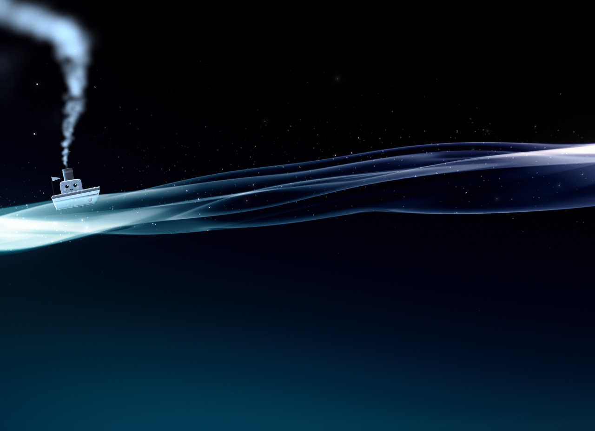

# Nagare

**The PlayStation 3's flowing XMB waves, as a live wallpaper for your Windows desktop.**



Nagare (流れ, "a flow") draws the PS3 menu's wave, its sparkles and its backdrop behind your desktop icons, live, at
the console's own pace, and it gives way to your games and apps when they need the PC. It is written in Rust, and draws
with Vulkan or OpenGL.

### ⬇️ [Download Nagare for Windows](https://github.com/bungholesurfers/Nagare/releases/latest)

The latest release has the installer and a portable zip, both for 64-bit Windows (x64). More in
[Getting it](#getting-it).

> **This repository's own work is in [`native/`](native/).** That is Nagare: the Rust app, its installer and its
> tooling. Everything else in the repository is the research Nagare is built on, kept here as it came from the two
> projects below, and it stays the reference: the Rust port follows it, constant for constant.

## Standing on the shoulders of

Nagare is a port, and the hard part was done before it existed.

- **[faquino/PlayStation-3-XMB](https://github.com/faquino/PlayStation-3-XMB)**, by Fran, reverse-engineered the scene
  from PS3 firmware 4.93 running in [RPCS3](https://rpcs3.net/). That covers:
  - the wave's line simulation, deformation lattice and B-spline surface (`custom_render_plugin`, `spline.elf`);
  - the sparkles' SPU task and emitter (`particles.elf`);
  - the backdrop's programs and the passes after the wave.

  Each was checked against savestates and frame captures, and written up in the reverse-engineering notes. The
  WebGL2 page in [`ps3xmbwave/`](ps3xmbwave/) is that work, and Nagare's wave, particles, backdrop and post-processing
  are ported from it, file for file.
- **[linkev/PlayStation-3-XMB](https://github.com/linkev/PlayStation-3-XMB)**, by Mart, started it all: the original
  WebGL recreation, which faquino's fork grew from. It is kept in [`old-research/`](old-research/), along with its
  credit to [Alphardex's CodePen](https://codepen.io/alphardex/pen/poPZNwE).

Their README is kept as [README.upstream.md](README.upstream.md). It covers the web version, the research, and how it
was done.

## What Nagare adds

- **A real desktop wallpaper.** It draws behind the desktop icons, reads the mouse off the desktop so the sparkles
  still react to it, and has a tray icon (the Norb). Ctrl+Alt+Shift+W toggles it. To open the settings, poke the
  desktop: click it 9 times in quick succession.
- **The scene, ported faithfully.** It uses the same wave, sparkles, backdrop, tone curve and glare as the research,
  with the console's own parameter sets through the day, the XMB's start and the music theme.
- **Three renderers.**
  - **Vulkan** (the default, through wgpu) builds the wave on the GPU, in compute passes.
  - **OpenGL 3.3** is the original renderer.
  - **Software** (WARP) is a fallback that leaves the heavy features out.

  If one fails, the next takes over.
- **Manners.** Nagare limits, pauses or fully stops itself when a game goes full screen, a window is maximized, a
  listed program runs, the PC is on battery, or the GPU's memory runs short. A stop frees the GPU's memory entirely.
  Its threads can be kept on efficiency cores, under EcoQoS.
- **Enhancements, all optional.** Bloom, tonemappers, auto exposure, an ALEXA-style film grain, FXAA, supersampling,
  sharpening and motion blur. With them off, you get the console's look.
- **Music mode.** When your PC plays music, the scene switches to the console's music theme, and then it really gets
  going ([try it](#try-it-with-music)).
- **Maru-chan.** A little glass steamboat sails the wave now and then.
- **Season Pass.** A tour of every month's backdrop colours, in order or shuffled.
- **A first start with ceremony.** On a PC it hasn't seen before, Nagare runs a short benchmark, which is how it picks
  its frame cap. Then come the photosensitivity warning and a card you may recognise from 2009 (albeit slightly political).
- **An installer** for your user account only, with no administrator needed, and a watchdog that restarts Nagare if it
  crashes. A customizer designs the logo and the installer's look.
- **Updates itself, if you say so.** Nagare first asks before it checks GitHub for a newer version. Then, every day or
  two, it fetches the new installer, checks that it carries the release key's signature, and asks you before installing
  it (a setting lets it install by itself instead). It sends nothing about you or your PC. It's the only thing Nagare uses the network for, and you can turn it off in the
  settings at any time.

Everything is set from one settings panel, with a tooltip on every setting. The details, including every option and
how each part works, are in [native/README.md](native/README.md).

## Getting it

Open the [latest release](https://github.com/bungholesurfers/Nagare/releases/latest). Its first two links are the
downloads:

- **Windows installer (x64)**, the easy way. Nagare installs into `%LOCALAPPDATA%\Programs\Nagare`, can start when you
  sign in, and uninstalls cleanly from Settings > Apps.
- **Portable zip (x64)**: the two exes, to unzip anywhere and run, with no Start menu entry and no start at sign-in.

Until the releases are code-signed, SmartScreen will warn about the download: choose *More info > Run anyway*. See
the [privacy policy](#privacy-policy) for what Nagare sends over the network.

Windows 10 or 11 is required, with a GPU that runs Vulkan or OpenGL 3.3 (or neither, with the software renderer).
The code also compiles for Linux and macOS, where Nagare would run as a window, but that is little tried. The
wallpaper, tray and installer are Windows only.

## Try it with music

Once Nagare is running, play some music, from any player or browser tab. Then turn it up, preferably something with
a lot of bass.

- **The theme changes.** Nagare notices the music and eases the scene into the console's music theme, its dank purple
  and all, as the PS3 did when you played music on it.
- **It moves with the music.** It listens to what your PC plays, and the wave brightens with how loud the music has
  been, with extra weight on the bass.
- **It bounces to the beat.** The camera bounces on every beat it finds. The bass line itself flickers the light and
  shakes the view at its own pitch, and the kicks give it a bop. Every move is motion-blurred, so it stays smooth
  rather than jittery.
- **The disco ball (albeit scuffed, disabled by default).** Turn on `discoBall` in the settings, keep the heavy bass
  going for a few minutes, and a disco ball comes down near the top right. Its beams sweep through the haze, and its
  glints flash with the beat.

When the music stops, it all winds down and the scene drifts back to the clock's colours. Prefer your own colours
under the music? Pick *Normal color* for `musicColourChoice` in the settings.

## Building

You need [Rust](https://rustup.rs/). [`native/rust-toolchain.toml`](native/rust-toolchain.toml) pins the compiler,
and rustup installs it on first use.

```bash
cd native
cargo run --release                 # behind the desktop icons, with a tray icon
cargo run --release -- --window     # in a window, with the settings panel
```

The build tasks are `cargo xtask` commands, a small Rust program in `native/xtask/`, so nothing else needs installing.
Run them from `native/`:

```bash
cargo xtask build                       # quick release build
cargo xtask check                       # clippy for Windows, Linux and macOS, and the tests, as CI runs them
cargo xtask pgo                         # profile-guided optimised build, about 20 minutes (needs a GPU)
cargo xtask installer --no-build        # package what's built (Inno Setup 6); --install installs it too
cargo xtask ready                       # everything before a commit: check, pgo, installer --no-build --install
cargo xtask help                        # the rest
```

The installer needs [Inno Setup 6](https://jrsoftware.org/isinfo.php). [native/README.md](native/README.md#build-and-pgo)
explains each task.

### GitHub workflows

- **[Native CI](.github/workflows/native-ci.yml)** runs on every push that touches `native/`. It runs clippy for
  Windows, Linux and macOS and the tests, then builds the app, and keeps the exes as the run's artifact.
- **[Native release](.github/workflows/native-release.yml)** runs on a `v*` tag. It builds with PGO from the profile
  kept in `native/pgo/`, packages the installer, and drafts a GitHub
  release. The release's body comes from [`.github/release-notes.md`](.github/release-notes.md), with the version
  filled into its download links.
  - The PGO training draws the scene, so it needs a real GPU. Record the profile on a PC with `cargo xtask pgo` and
    commit `native/pgo/`.
  - The release also gets Software Update's signed manifest, `nagare-update.json`, which needs the repository secret
    `NAGARE_UPDATE_KEY`. Copies of Nagare move to a release only once its tag is in
    [`update/stable.txt`](update/README.md).

## Privacy policy

Nagare will not transfer any information to other networked systems unless you ask it to. Its one use of the network
is **Software Update**:

- Nagare asks first, on its first start. Until you answer OK (or close the question), nothing is sent.
- When on, every day or two it fetches a small text file and, when a newer version is out, that version's signed
  update files from GitHub, over HTTPS. The requests carry nothing about you or your PC, beyond what any download
  shows: GitHub sees your IP address, as described in the
  [GitHub privacy statement](https://docs.github.com/site-policy/privacy-policies/github-general-privacy-statement).
- You can turn it off at any time in the settings, under *Software Update: Auto-check*.

Everything else Nagare does stays on your PC: listening to the music you play (to move the scene), reading which
media app is playing, watching for full-screen programs, and its settings file.

## Not affiliated with Sony

Nagare is an unofficial, non-commercial fan project. It is not affiliated with, endorsed by or sponsored by Sony
Interactive Entertainment.

- "PlayStation", "PS3" and "XMB" are trademarks of Sony Interactive Entertainment Inc., used here only to say what
  Nagare recreates.
- No Sony firmware, code, shaders or assets are in this repository or in Nagare. The shaders are written anew, and
  the textures the scene needs are generated or fitted. The reverse-engineering tools in `tools/re/` only read
  firmware you already have.

## License

[MIT](LICENSE), as the projects it comes from. Copyright © 2025 Mart, © 2026 Fran, and Nagare's contributors.

Thanks to the RPCS3 team, whose emulator made the reverse engineering possible, and to everyone at Sony and Q-Games
who made the XMB. It is still the best console interface there is.
